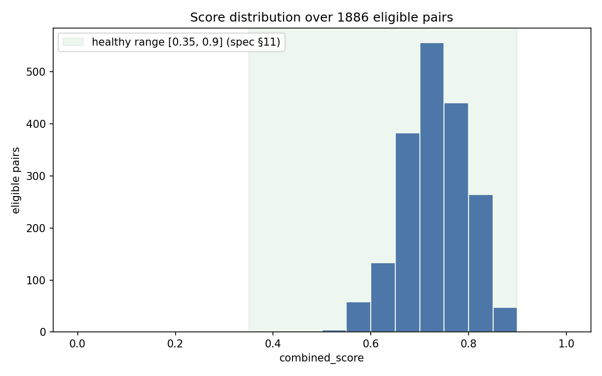
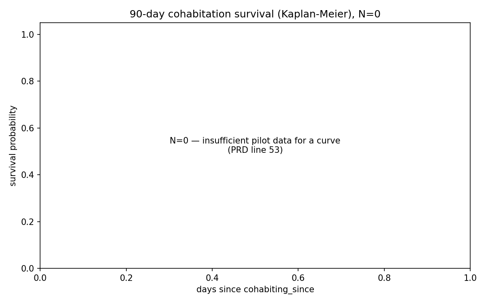

# Cohab — Evaluation

Phase 9 of `COHAB_BUILD_PLAN.md` §4 ("Evaluation and polish"). This is the
evaluation chapter the roadmap (`COHAB_PRD.md` §14, row 9: "Evaluation,
report, demo") names, covering the four techniques `COHAB_PRD.md` §15
"Evaluation — v1" lists: ranking metrics (precision@k, NDCG@10), ablation
studies, distributional analysis of scores and filter yield, and Kaplan–Meier
survival analysis for the 90-day cohabitation metric.

Generated by `python -m cohab.services.matching.evaluation` (see that
module's own docstring for the full run instructions) against the dev DB as
it stood on **2026-08-20**: 1,532 profiles with a preference profile, active
`weight_set` v3 (identical weights to v2 — see the note under §3). Numbers
below are transcribed verbatim from that run, not predicted; the two PNGs
are the actual chart files it wrote to `docs/evaluation/`. Re-running the
script will overwrite both charts and will not reproduce the exact same
numbers if the dev DB has changed since (more profiles seeded, more manual
test accounts created, etc.) — the run itself is fully reproducible given the
same DB state and `RNG_SEED = 9`.

## The caveat that governs every number below

`COHAB_PRD.md` §6.6 is explicit: synthetic data "validates the machine, not
the theory," and a performance figure computed on it — precision@k, NDCG,
accuracy — "must never be reported as evidence that the matching works."
Every profile behind every number in this document is synthetic
(`cohab/seed.py`, plus a handful of manually-created accounts from earlier
phases' live-verification passes — Cohab has no real users, and per
`COHAB_PRD.md` §6.6/D-2.5 is not expected to during the pilot). So:

- §1–§3 (filter yield, score distribution, ablation) are legitimate uses of
  synthetic data per §6.6's own table — they're properties of the scoring
  function and the marginal distributions of budget/locality/move-in date,
  not claims about real compatibility.
- §4 (precision@k/NDCG@10) is a **recovery experiment**, the specific
  legitimate use §6.6 names for a performance figure like this: it plants a
  known ordering and checks whether the real pipeline recovers it. **It
  validates the implementation's wiring. It is not, and must never be cited
  as, evidence that Cohab's matching improves real roommate outcomes.**
- §5 (survival analysis) is real instrumentation running against whatever
  real interaction data exists — currently none, which `COHAB_PRD.md` line 53
  anticipates explicitly ("this will not be measurable inside the project
  timeline; the instrumentation is built anyway").

## 1. Filter yield

| | |
|---|---|
| Sample | 60 subjects, pool = 1,532 |
| Eligible pool | min = 1, **median = 37.5**, max = 447 |
| Target | meets both spec §11's 10 and PRD §2's 15 |

Exclusion reasons, most common first:

| Reason | Count |
|---|---|
| `budget_no_overlap` | 48,337 |
| `both_have_place` | 13,671 |
| `gender_preference` | 10,855 |
| `not_verified_or_active` | 8,940 |
| `move_in_too_far` | 5,118 |
| `pet_conflict` | 766 |
| `smoking_dealbreaker` | 538 |

Consistent with D-3.1/D-3.2's Phase 3 finding: budget remains the dominant
exclusion by a wide margin even on the correlated seed, which is expected
(real rental markets stratify hard on price) rather than a defect. The
median of 37.5 comfortably clears both stated targets, so no config change
(`MOVE_IN_TOLERANCE_DAYS`, currently 30) is warranted by this run, matching
D-3.2's own conclusion.

## 2. Score distribution

Over 1,886 eligible pairs (40-subject sample): min 0.518, p25 0.689,
**median 0.733**, p75 0.780, max 0.894, mean 0.733. 100% inside spec §11's
healthy range [0.35, 0.90]. 53% fall inside [0.70, 0.80] — spec §11 item 3's
own bunching signature.

This is essentially unchanged from D-3.2's Phase 3 measurement (57% bunched
in the same band on a smaller sample) and confirms the "open, not acted on"
note recorded there: the compression is very likely inherent to a ~20-term
weighted sum with mostly gentle-floored similarity matrices — one weak
attribute gets diluted across the whole vector rather than dragging the
combined score down sharply — not a bug introduced since. Flagged again
here rather than adjusted: changing matrix floors or weights to spread the
distribution further is a matching-design decision, not something this
evaluation phase should do as a side effect of measuring it (CLAUDE.md's
"one phase per session" discipline).

## 3. Ablation — marginal contribution of all 20 scored attributes

15 subjects, full pool, active `weight_set` (v3 — published during a later
phase's manual API testing with the same weights as v2, `weight_set.py`'s
own immutability rules mean this is a normal republish artifact of this dev
DB's history, not a data problem). For each attribute: its production
weight, mean `|Δcombined_score|` when zeroed, average top-10 overlap against
the un-ablated ranking, how often the #1-ranked candidate changed, and the
Spearman rank correlation between the baseline and ablated ranking (1.0 =
ablating this attribute never reorders anything).

| Attribute | Weight | mean&#124;Δscore&#124; | Top-10 overlap | #1 changed | Spearman |
|---|---:|---:|---:|---:|---:|
| cleanliness_level | 0.110 | 0.0251 | 6.9/10 | 6/15 | 0.903 |
| chore_approach | 0.060 | 0.0145 | 8.3/10 | 5/15 | 0.967 |
| sharing_norm | 0.040 | 0.0078 | 9.1/10 | 3/15 | 0.992 |
| sleep_schedule | 0.090 | 0.0218 | 8.4/10 | **10/15** | 0.928 |
| noise | 0.090 | 0.0124 | 8.4/10 | 2/15 | 0.969 |
| guests | 0.100 | 0.0232 | 8.1/10 | 5/15 | 0.949 |
| payment_reliability | 0.080 | 0.0153 | 9.1/10 | 1/15 | 0.962 |
| cost_split_preference | 0.030 | 0.0046 | 9.2/10 | 0/15 | 0.996 |
| communication_style | 0.080 | 0.0179 | 8.2/10 | 5/15 | 0.954 |
| budget_proximity | 0.060 | 0.0121 | 9.3/10 | 2/15 | 0.998 |
| diet | 0.030 | 0.0056 | 8.9/10 | 2/15 | 0.994 |
| nonveg_cooking | 0.030 | 0.0051 | 9.3/10 | 3/15 | 0.997 |
| smoking | 0.030 | 0.0053 | 9.3/10 | 2/15 | 0.995 |
| alcohol | 0.020 | 0.0034 | 9.1/10 | 1/15 | 0.998 |
| life_stage | 0.040 | 0.0049 | 8.9/10 | 2/15 | 0.994 |
| daytime_presence | 0.020 | 0.0047 | 8.8/10 | 3/15 | 0.996 |
| home_orientation | 0.020 | 0.0051 | 9.0/10 | 4/15 | 0.995 |
| sociability | 0.020 | 0.0036 | 9.3/10 | 0/15 | 0.997 |
| interests | 0.020 | 0.0116 | 9.4/10 | 1/15 | 0.999 |
| lifestyle_notes | 0.030 | 0.0140 | 8.9/10 | 1/15 | 0.995 |

**The spec §11 item 6 four, revisited with a cleaner statistic.** Phase 3
(D-3.2) flagged `sharing_norm`, `home_orientation`, `sociability` and
`cost_split_preference` as worth scrutiny (low weights that might be
over/under-discounted) but found "no clean signal" from a 15-subject,
top-10-overlap-only sample. This run's Spearman correlations for the same
four — 0.992, 0.995, 0.997, 0.996 — are among the *highest* (least
disruptive) of all 20 attributes. That confirms D-3.2's non-change decision
more cleanly than Phase 3 could: none of the four is a candidate to drop or
reweight; the low weights spec §8 already assigns them are doing what a low
weight should.

**Two findings worth the report's own attention, not acted on here (same
"flag rather than silently fix" discipline as §2):**

- `cleanliness_level` (the single highest weight, 0.11) has the lowest
  Spearman (0.903) and lowest top-10 overlap (6.9/10) of any attribute — the
  ranking is most sensitive to it, which is the expected shape for the
  highest-weighted term in a weighted sum, not a surprise.
- `sleep_schedule` (weight 0.09, mid-table) changed the **#1**-ranked
  candidate in 10 of 15 subjects — the highest rate of any attribute in the
  table, higher even than `cleanliness_level`'s 6/15 despite its lower
  weight and much better Spearman/overlap numbers. So `sleep_schedule`
  barely disturbs the ranking *overall* but disproportionately decides
  *who ends up first* specifically. That's exactly the kind of thing an
  ablation study is for surfacing; whether it's worth a weight adjustment is
  a matching-design question for a future phase, not this one.

## 4. Precision@k / NDCG@10 — recovery experiment

**Method** (`cohab/services/matching/recovery.py`, D-9.1 below):
for each of 20 real subjects, 30 synthetic candidates are constructed across
5 relevance grades (0/25/50/75/100% of 17 scored attributes deliberately
swapped to the value the *existing, spec-sourced* similarity/tolerance
matrices already record as least compatible with the subject's own answer —
no new compatibility model invented). `budget_proximity`, `interests` and
`lifestyle_notes` are held constant (D-9.1). The real, unmodified
`CompatibilityMatcher`/`MatchRanker` pipeline then ranks all 30; precision@k
and NDCG@10 measure whether it recovered the construction order.

| Metric | Value |
|---|---:|
| precision@5 | **1.000** |
| precision@10 | **0.990** |
| NDCG@10 | **0.998** |

**Reading this correctly:** near-perfect recovery is the *expected* result
of a correctly-implemented weighted-sum-plus-harmonic-mean pipeline against
a ground truth built directly from its own scoring primitives — this is a
positive result about the **implementation's wiring** (eligibility
filtering never excludes a deliberately-more-compatible candidate,
directional scoring and the harmonic-mean combination behave monotonically,
`MatchRanker.rank()`'s sort is correct). Restating §6.6's caveat plainly:
**this number says nothing about whether similar-on-these-attributes
roommates actually cohabit more successfully** — that question is exactly
what §5 exists to eventually answer, and can't be answered by construction.

The bug worth recording precisely because most of it was *not* caught by
unit tests: the first version of the candidate construction copied the
subject's own `gender`, `gender_preference`, `seeker_type`, pet, allergy
and smoking-dealbreaker fields onto every synthetic candidate on the
assumption that identical Stage-1 fields trivially clear Stage 1. That's
false whenever a subject's own preference doesn't accept their own value on
the matching side of one of `eligibility.py`'s checks (e.g. a subject
seeking only the opposite gender, or a `has_place` subject, whose own type
collides with itself under the "two place-owners" rule). Running the
experiment against the real, diverse seeded pool — not the fixture
defaults, which happen to avoid every one of these — silently zeroed out
most subjects' scores across four separate live rounds (precision@5/10/
NDCG@10 first landed at exactly 0.300, the fraction of subjects that
happened to clear Stage 1 by luck). A fifth, related gap —
`verification_status`/`account_status` — was never triggered live at all
(this script only ever samples already-verified subjects) and was instead
caught by a `/code-review high` pass before this phase was committed. See
D-9.2 below and `recovery.py`'s own docstrings for the full fix.

## 5. Survival analysis — 90-day cohabitation (the primary outcome)

`cohab/services/matching/survival.py`'s Kaplan–Meier estimator, run against
every real `match_score` row that reached `cohabiting`, reconciled against
its `feedback` rows (D-9.3 — including a fix, found by code review before
this phase was committed, for a `moved_out` report submitted without a
duration: it was silently miscounted as censored rather than as an event).

**Observations: 0** (0 events, 0 censored) — no `match_score` has reached
`cohabiting` in this dev DB yet.

This is the expected, anticipated state, not a failure: PRD line 53 states
plainly that the 90-day survival metric "will not be measurable inside the
project timeline; the instrumentation is built anyway." No synthetic
outcome data is substituted to produce a more populated-looking curve
(D-9.4) — doing so would be exactly the kind of invented-value
presentation CLAUDE.md forbids, and precisely the circularity §6.6 warns
against, applied to the metric PRD itself calls out as most sensitive to
being reported honestly. The estimator's correctness is instead established
by hand-computed unit tests (`tests/matching/test_survival.py`) against a
worked example — see that file's own comments for the arithmetic.

## Not recomputed here

The TF-IDF-vs-`EmbeddingSimilarity` comparison PRD §7 calls "a reportable
result" was already run and recorded in Phase 3 (D-3.2/D-3.3): Pearson
r = 0.694 between the two over 150 sampled pairs, mean |difference| = 0.301,
with embeddings catching paraphrase-level semantic equivalence TF-IDF
structurally cannot. Cited here rather than rerun — an already-settled
finding, not something this phase repeats.

## Summary

| Check | Result |
|---|---|
| Filter yield | median 37.5 — clears both stated targets |
| Score distribution | 100% in the healthy range; bunched around 0.70–0.80 (flagged, not new) |
| Ablation | weight ranking broadly predicts marginal contribution; spec §11's four flagged attributes confirmed low-impact |
| Precision@5 / @10 / NDCG@10 | 1.000 / 0.990 / 0.998 — the pipeline recovers a known, planted ordering (implementation validation only, PRD §6.6) |
| Survival (N) | 0 — anticipated by PRD line 53; instrumentation built and unit-tested, ready for real pilot data |

See `docs/DECISIONS.md`'s Phase 9 section (D-9.1 through D-9.6) for the full
set of non-obvious design decisions behind the methodology above, each named
against the document section it isn't already fixed by — including the
bugs a `/code-review high` pass found and fixed before this phase was
committed (D-9.2, D-9.3, D-9.6).
