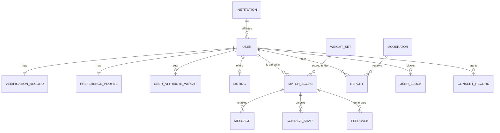
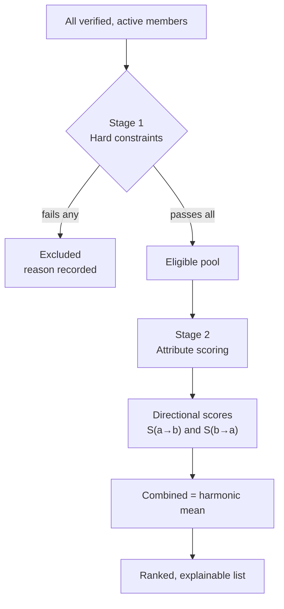
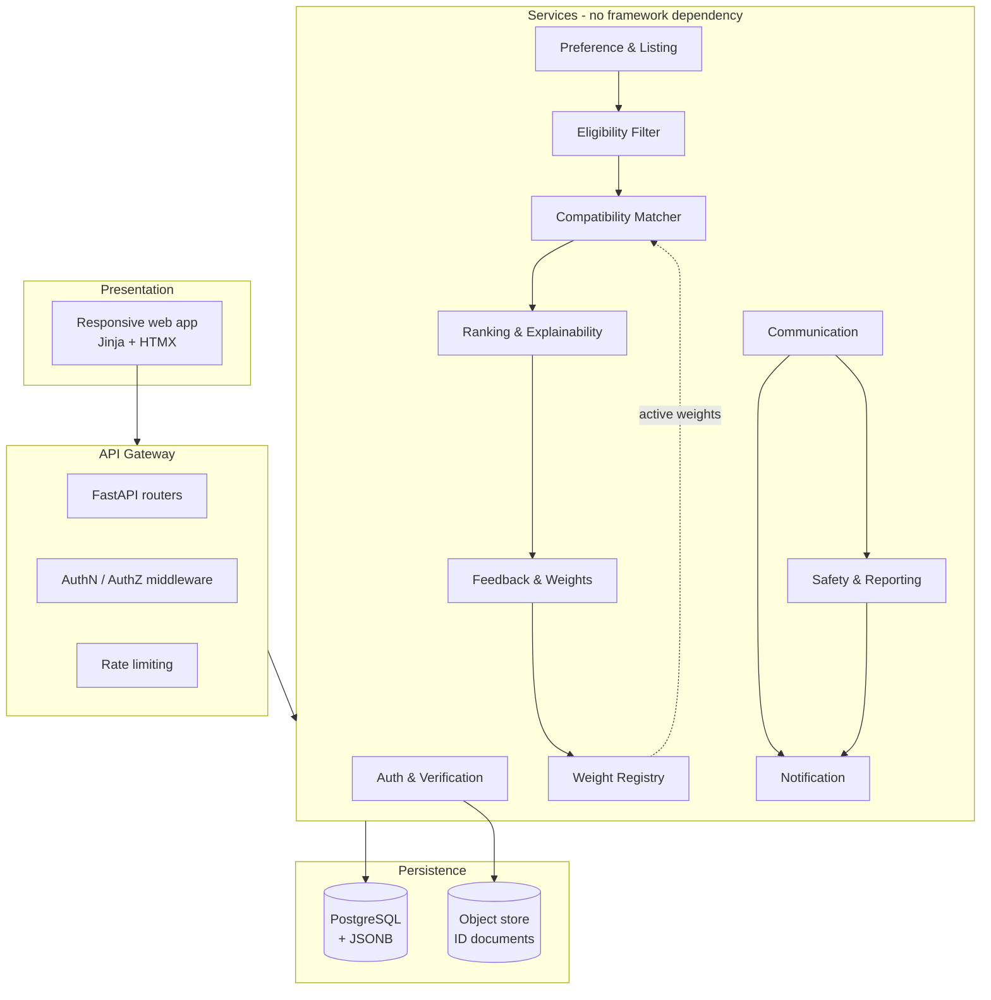
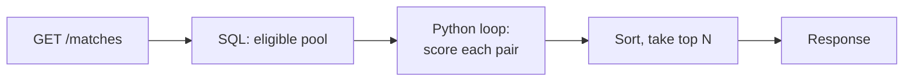
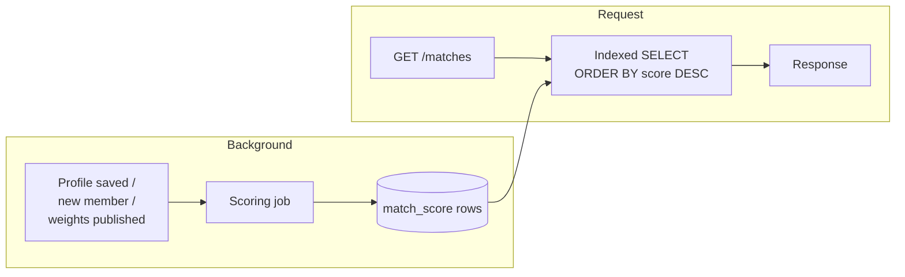
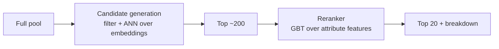
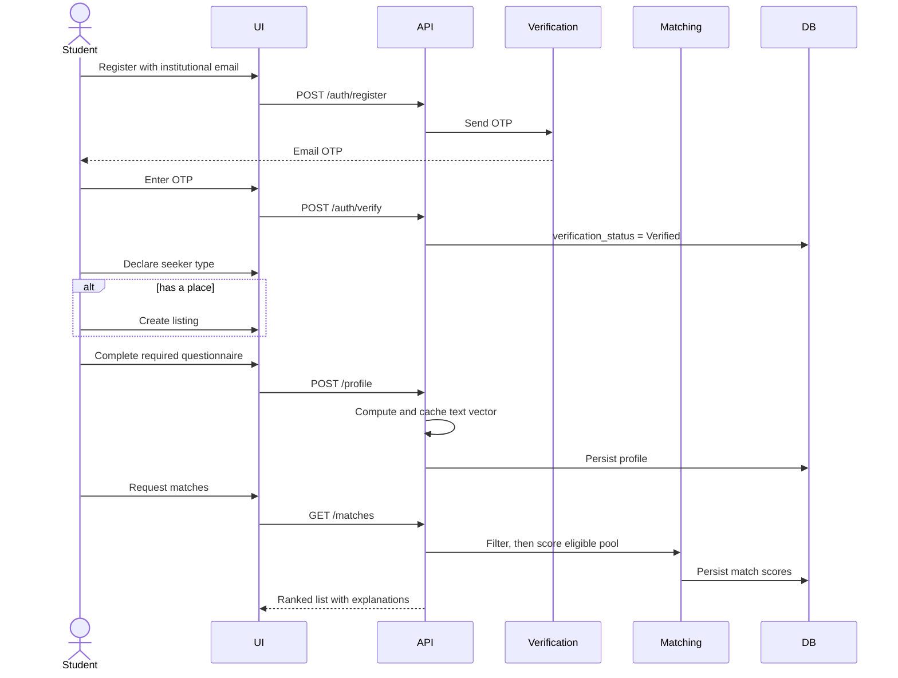
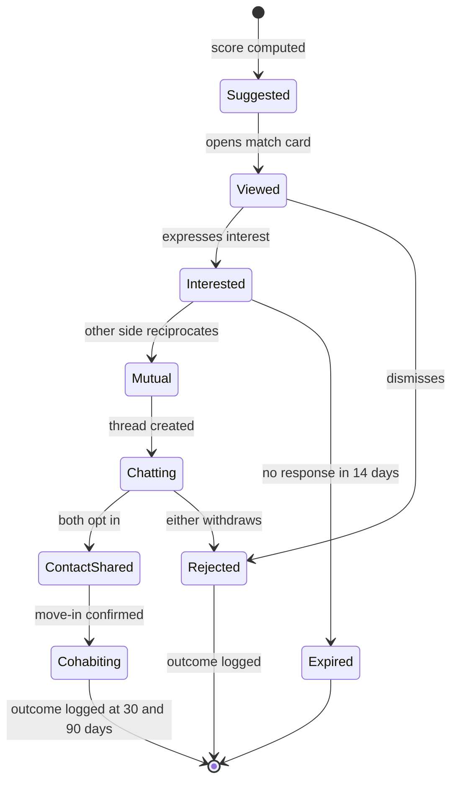
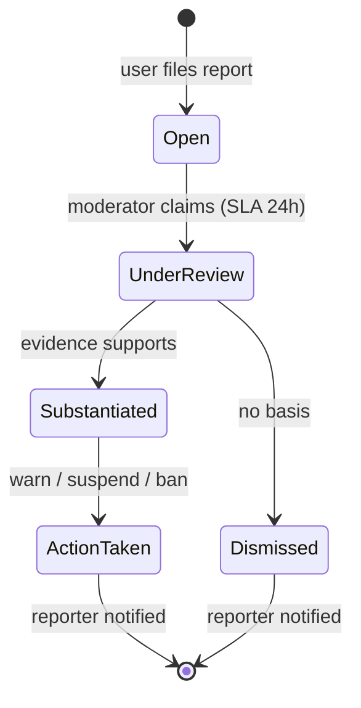

# Cohab — Product Requirements Document

**Version:** 1.0
**Authors:** Puranjyoti Bera (2548035), Alwin N Joseph (2548006)
**Guide:** Dr Sathya P
**Status:** Draft for build
**Companion documents:** `COHAB_MATCHING_SPEC.md` (questionnaire and scoring numbers), `SDD.md` (system design), `SRS.pdf` (requirements, superseded where they conflict)

---

## 1. Problem

Finding a roommate in India is an unstructured, high-stakes decision made on almost no information. The current process runs through referrals, WhatsApp and Telegram groups, and generic classifieds. Three things go wrong:

**Identity is unverified.** Listings and profiles carry no reliable claim about who the person is. There is no accountability if someone misrepresents themselves, and no recourse if a situation turns unsafe.

**Lifestyle expectations are never compared before move-in.** People negotiate rent and location — the things that are easy to state — and discover cleanliness standards, sleep schedules, guest habits and money reliability only after signing. Between 60% and 70% of students living with roommates report conflict, and over 30% of renters report a serious dispute within the past year.

**The failure is expensive.** A bad match means an early move-out, a lost deposit, disrupted study, and in the documented cases, measurably worse academic outcomes — roughly a quarter of affected students report late attendance and lower grades.

The information that would predict these failures is knowable in advance. Nobody collects it.

### 1.1 Why now, and why this approach

The dimensions that cause roommate breakdown are well documented and stable across studies: cleanliness, noise and sleep, guests, money, and sharing of property. They are all askable in a short questionnaire. The gap is not that the data is hard to obtain — it is that no platform in this market asks for it and then does anything structured with the answers.

---

## 2. Goals and non-goals

### Goals

1. Make identity verification a precondition of participation, not an optional badge.
2. Capture lifestyle expectations in a structured form before any introduction is made.
3. Produce a ranked shortlist where every ranking is explainable in plain language.
4. Prevent structurally impossible matches from being shown at all, regardless of how well they score elsewhere.
5. Keep the final decision with the user. The system ranks and explains; it never assigns.
6. Withhold personal contact information until both parties consent.
7. Improve the scoring from real outcomes rather than leaving it fixed at its initial configuration.

### Non-goals

| Not doing | Why |
|---|---|
| Property listings / rental marketplace | Cohab matches people, not properties. A flat's rent and photos exist only as context on a member's listing, not as a searchable inventory. |
| Dating or friendship | Adjacent and tempting, and a different problem. Shared hobbies predict friendship, not successful cohabitation. Conflating them produces a friend-finder that fails at its stated job. |
| Rent collection or payments | Regulatory and trust burden far beyond scope. |
| Legal agreements or dispute arbitration | We may provide a roommate-agreement template as content. We do not adjudicate. |
| Automatic assignment of roommates | Explicitly rejected. Institutional batch allocation is designed (SDD §10.6) but stays opt-in and out of v1. |

### Success metrics

**Primary (the real question):** 90-day cohabitation survival rate — the proportion of matched pairs still living together three months after move-in. This will not be measurable inside the project timeline; the instrumentation is built anyway, because a system that does not collect it during the pilot can never answer the question afterwards.

**Pilot-measurable:**

| Metric | Target for pilot |
|---|---|
| Questionnaire completion rate | ≥ 70% of registrations |
| Median eligible pool size after hard filters | ≥ 15 candidates |
| Match acceptance rate (reaching Mutual) | ≥ 20% of suggestions |
| Median time to first message | < 24 hours |
| Contact-share rate among chatting pairs | ≥ 30% |
| Reports per 1,000 matches | < 5 (counter-metric) |

The report rate is a counter-metric. An improvement in acceptance rate accompanied by a rise in reports is not an improvement.

---

## 3. Users

### 3.1 v1 scope: single-campus pilot

Version 1 targets **Christ University students in Bangalore**. This is a deliberate constraint, not a lack of ambition.

The reason is the eligibility filter. Cohab excludes candidates who fail on city, budget overlap, move-in date, gender preference or deal-breakers — and those conditions conjoin quickly. A thousand users spread across Bangalore might leave the median person with three viable candidates. A hundred users from one campus, all looking in the same few localities within the same intake window, produces a denser pool than ten times that number scattered across a city. **Density beats volume**, and a single campus is the cheapest way to buy density.

Everything is designed to scale beyond this — institution is already a first-class entity — but v1 succeeds or fails on one campus.

### 3.2 Personas

**Priya — first-year postgraduate, new to Bangalore.** Has never lived away from home. Knows nobody in the city. Currently choosing between a PG she dislikes and a WhatsApp group full of strangers. Her fear is safety; her constraint is a ₹12,000 budget; her need is someone who will not make her first year miserable. She is the primary persona.

**Rohan — second-year, has a flat, one roommate leaving.** Needs one person to fill a room by the 1st of next month or he covers the full rent himself. He is time-pressured and specific: the room is fixed, the rent is fixed, and he cares most about whether the person pays reliably and does not bring people over constantly. He represents the *has-a-place* side, and roughly half the real market.

**Dr Sathya's department office — institutional partner.** Wants aggregated visibility into whether students are housed and where problems cluster. Read-only, anonymised. Low priority for v1 but the reason institutions cooperate with the pilot.

---

## 4. Scope

### v1 — the pilot

- Registration and institutional email verification
- Questionnaire: required core plus optional depth
- Both seeker types: *needs a place* and *has a place*
- Listings, for members who have a place
- Two-stage matching with explanations
- Mutual interest, then chat
- Mutual contact-sharing consent
- Reporting and blocking, with moderator review
- Outcome logging

### v2 — after the pilot

- Institutional analytics dashboard
- Learned ranking from outcome data
- Group matching (three or four people)
- Notification channels beyond email

### Later

- Irving's stable-roommates batch allocation for institutional intake
- Multi-city, multi-institution
- Operator integrations with PG and co-living providers

---

## 5. Domain model

### 5.1 Seeker types and listings

A member is one of two types, and this drives eligibility:

- **`needs_place`** — looking for both a person and somewhere to live
- **`has_place`** — has a flat with a room to fill

The compatibility rule is a hard constraint:

| A | B | Compatible? | Why |
|---|---|---|---|
| needs_place | needs_place | Yes | They search together |
| needs_place | has_place | Yes | One joins the other |
| has_place | has_place | **No** | Neither is moving |

Two people with flats have nothing to offer each other. Without this rule they would match on lifestyle and waste each other's time — a failure mode the original symmetric design could not express.

A `has_place` member creates a **listing**: locality, rent per person, deposit, room type, available-from date, amenities, photos, current number of housemates. The listing supplies the hard-constraint values (locality, rent, date) for that side of the pair, replacing their stated preferences. Someone with a flat is not expressing a budget preference; they are stating a price.

### 5.2 Entities

Building on the SDD ERD, with additions marked.

| Entity | Purpose |
|---|---|
| `institution` | Campus or operator |
| `user` | Account, verification and moderation status, **seeker_type** ← new |
| `verification_record` | How and when identity was established |
| `preference_profile` | Questionnaire answers, hard constraints, embedding reference |
| `user_attribute_weight` | Each user's declared importance per attribute |
| **`listing`** ← new | Room offered by a `has_place` member |
| `weight_set` | Versioned, immutable platform weight vectors |
| `match_score` | Directional and combined scores, breakdown, state |
| `message` | Chat, encrypted at rest |
| `contact_share` | Per-participant consent to release contact details |
| `feedback` | Outcome, cohabitation duration |
| `report`, `moderator`, `user_block` | Safety |
| `consent_record` | Purpose-specific consent under the DPDP Act |



**Invariants that must hold in the schema, not just in code:**

- `match_score`: `CHECK (user_id_a < user_id_b)` and `UNIQUE (user_id_a, user_id_b)`. A pair is unordered; without canonical ordering the same pair inserts twice and every downstream count doubles.
- `feedback`: `UNIQUE (score_id, submitted_by)` — each participant reports once.
- `contact_share`: `UNIQUE (score_id, user_id)` — consent recorded once per person, so "both consented" is a count of two.
- `preference_profile`: `CHECK (budget_min <= budget_max)`.
- Budget is two integers. Never a string.

---

## 6. The matching approach

Full detail, including every number, is in `COHAB_MATCHING_SPEC.md`. This section states the approach and the reasoning.

### 6.1 Constraints before preferences

Roommate compatibility is not one graded quantity. Some requirements admit degrees — you prefer an early riser but could live with a night owl. Others are binary: a candidate in a different city, outside your budget, or available six months from now is not a weak match but an impossible one.

A single weighted sum cannot express this. If every attribute contributes proportionally, a candidate scoring well on sleep, cleanliness and interests accumulates a high total while failing on budget, and is presented as a strong recommendation. Raising the weight on budget does not fix it — it only raises the bar the candidate must clear elsewhere. The failure stays *compensable in principle*, and that is the defect.

So: **Stage 1 filters, Stage 2 scores.**



Stage 1 is an indexed query that typically removes the large majority of the pool, so the expensive Stage 2 work runs on a set one or two orders of magnitude smaller. Correctness and performance point the same way here.

### 6.2 Four kinds of attribute

The most significant departure from the SDD. The original design treated every attribute as a similarity comparison. That is wrong for three of the four types.

**Hard constraints** — boolean. City, budget overlap, move-in window, gender preference, seeker-type compatibility, severe allergies, pets, blocks.

**Similarity attributes** — closer is better, symmetric. Sleep schedule, cleanliness standard, chore approach, communication style, interests. Two relaxed people coexist happily; so do two very tidy people. The match is in the agreement, not the level.

**Tolerance attributes** — asymmetric, and this is the important one. What matters is whether *A tolerates B's behaviour*, which is a different question from whether they are similar. A smoker and a non-smoker who genuinely does not mind are perfectly compatible; two people who both dislike smoke but one of whom smokes are not. Guests work the same way: what matters is B's guest frequency against A's comfort with guests, not whether their guest habits resemble each other. Modelling these as similarity produces visibly wrong answers.

**Absolute attributes** — higher is better regardless of your own value. Money reliability is the case. Over 20% of renters name non-payment as immediately terminable. Nobody wants to be matched with someone equally unreliable, so similarity is exactly the wrong comparison. The score depends only on the *other* person's value.

Tolerance and absolute attributes are naturally directional, which is why the scoring is computed twice.

### 6.3 Directional scoring

Two people rarely weight things identically. Priya may consider money reliability decisive and food incidental; Rohan the reverse. A single symmetric score with one shared weight vector averages that difference away.

So compute `S(a→b)` using A's importance weights and `S(b→a)` using B's, then combine with a **harmonic mean**. The harmonic mean punishes lopsidedness: scores of 0.9 and 0.3 give an arithmetic mean of 0.60, which reads as acceptable, and a harmonic mean of 0.45, which is the honest answer, because one of the two people is going to be unhappy.

### 6.4 Explanation

Explanations are not generated separately — they are the per-attribute scores already computed, rendered through templates. Each match card shows the **top three agreements and the single largest divergence.**

Showing a divergence is deliberate. Research on roommate satisfaction finds that *perceived* similarity predicts outcomes more strongly than actual similarity, which means the explanation screen is doing part of the work the algorithm takes credit for. A screen that only ever shows agreement invites distrust; naming the one real difference makes the agreements credible, and it surfaces the conversation the pair most needs to have before moving in.

### 6.5 Weight refinement — three tiers, not two

The SDD proposes moving from hand-assigned weights directly to a gradient-boosted tree ranking model. That jump is too large, and skipping the step between them is a mistake this PRD corrects.

| Tier | Method | Outcomes needed | Explainable? | When |
|---|---|---|---|---|
| 1 | Expert-assigned weights | none | Yes | v1 |
| 2 | **Fitted weights** — regularised logistic regression over the attribute-similarity vector; the coefficients *become* the new weight vector | hundreds | Yes | v2 |
| 3 | GBT reranker over the same features | thousands | Only via SHAP | Later |

**Why tier 2 belongs here.** There are ~20 weights. Estimating 20 coefficients is a far smaller statistical problem than fitting a tree ensemble, and it is achievable with a few hundred labelled outcomes rather than several thousand. It preserves the scoring architecture exactly, so explainability survives untouched — the output is still a weighted sum. This is precisely what the versioned `weight_set` table was designed to hold.

**Why tier 3 is dangerous if reached early.** A GBT over 20 features fitted on tens of outcomes will overfit completely and produce coefficients that look learned and are noise. It also cannot generate "you both keep things very tidy, but she has guests over weekly" — the best available substitute is SHAP attribution, which explains the model rather than the reasoning and does not belong on a match card. When tier 3 arrives it should sit in the reranking stage (§7.1 Stage C) with the weighted sum retained beneath it for explanation.

**The label problem.** The abundant label — *pursued* — is weak: it records a click, not a successful cohabitation. The label that matters — 90-day survival — is the rarest and slowest. Training on the abundant one produces a model that predicts clicks, optimising for profiles that look appealing rather than people who are compatible. That failure mode quietly converts Cohab into a ranked attractiveness list, and it must be guarded against explicitly whenever a model is fitted.

**Selection bias.** Outcomes are observed only for matches the system chose to display, mostly those near the top. Training naively on that data confirms the ranking that produced it, and the loop converges on its own initial assumptions rather than on evidence. Two mitigations, designed now and enabled with tier 2: an exploration parameter promoting a small fraction of lower-ranked candidates, and position logging so outcomes can be inverse-propensity weighted.

**Immutability.** Weight sets are immutable once published, and every `match_score` stores the `weight_set_id` it was computed under. Without this, an explanation shown in March cannot be reproduced in June, and the explainability guarantee holds only at the instant a score is first displayed.

### 6.6 What synthetic data can and cannot do

Synthetic profiles are essential to this project and are generated from Phase 1. It is important to be precise about what they establish.

**Legitimate uses:**

| Use | Why it works |
|---|---|
| Pipeline testing | Does the code run, rank, and render explanations correctly? |
| Load testing against the 5-second target | Requires volume, and volume is all that is required |
| Filter-yield analysis | Depends on the *marginal distributions* of budget, locality and move-in date, which can be modelled realistically from public rental data |
| Sanity-checking the matrices | Reading a top-10 list and judging whether it looks sensible is valid human judgement regardless of how the profiles were produced |
| Ablation and sensitivity analysis | These are properties of the scoring function, not of reality |
| Recovery experiments | Plant a known compatibility function in the generator, confirm the matcher recovers it — this validates the implementation |

**The circularity trap.** Synthetic data can generate features. It cannot generate informative *labels*. To produce synthetic outcomes, one must first decide what makes a match succeed — but that decision is exactly what the model is meant to learn. A generator encoding "similar cleanliness predicts survival" will train a model that discovers similar cleanliness predicts survival. The model has recovered the generator's assumption, not a fact about roommates.

**Synthetic data therefore validates the machine, not the theory.** Any performance figure computed on it — precision@k, NDCG, accuracy — describes the generator and must never be reported as evidence that the matching works.

**Semi-synthetic labelling — the practical middle path.** Real labels can be obtained without waiting 90 days: present 40–60 synthetic profile *pairs* to a sample of students and ask "could you live with this person, and why?" The profiles are synthetic; the judgements are real. This is a one-week exercise using a form, it produces genuine labels for weight calibration, and it is defensible in a way that fully synthetic outcomes are not. It is the recommended source of tier-2 training data within the project timeline.

---

## 7. Architecture



**Orchestration is server-side.** The client issues intent-level requests — "give me my matches", "open a chat with this person" — and the gateway sequences the service calls. A client that orchestrates can be modified to skip steps, and the steps it would skip are verification checks, consent capture and rate limits.

**Backend:** Python 3.11, FastAPI, SQLAlchemy 2.x, Alembic, PostgreSQL, pytest.

**Frontend:** React 18 + Vite + TypeScript, Tailwind CSS, shadcn/ui components, React Router, TanStack Query for server state.

The frontend is a single-page application consuming the REST API. Chat uses a WebSocket for live delivery, with REST for history and initial load.

**Deployment shape — same origin.** The React bundle is built (`vite build`) and served as static files by FastAPI in production. This is a deliberate choice: it makes the app same-origin, which eliminates CORS configuration in production entirely, permits `httpOnly` session cookies rather than browser-accessible token storage, and keeps deployment to a single container. In development, Vite's dev server proxies `/api` to the FastAPI process, so CORS is avoided there too.

```
Development:  localhost:5173 (Vite)  --proxy /api-->  localhost:8000 (FastAPI)
Production:   FastAPI serves both the API and the built static bundle
```

**Authentication:** session token in an `httpOnly`, `SameSite=Lax`, `Secure` cookie — not `localStorage`. Given that the platform holds identity documents, private messages and contact details, a token readable by any injected script is not an acceptable risk. Same-origin deployment is what makes cookie auth straightforward.

**The API contract is the boundary.** The services layer has no knowledge of React; every business rule is enforced server-side. A client that orchestrates can be modified to skip steps, and the steps it would skip are verification checks, consent capture and rate limits.

**Two deliberate deviations from the SDD**, to be recorded in the final report:

- *MongoDB → PostgreSQL `JSONB`.* The design argument was schema flexibility for an evolving questionnaire. A `JSONB` column provides exactly that without a second database to operate. The relational columns hold the filterable projection; the JSONB document holds the full questionnaire response including questions not yet promoted to columns.
- *Text similarity behind an interface.* `TfidfSimilarity` ships first; `EmbeddingSimilarity` (sentence-transformers) swaps in once the pipeline works end to end. Both are in v1. Building TF-IDF first means never being blocked on a 2 GB PyTorch install while getting the core algorithm right, and the comparison between them becomes a reportable result.

**Performance.** The SRS requires ranked matches against 5,000 candidates in under 5 seconds. Two things make this achievable: Stage 1 runs as an indexed query rather than an in-memory scan, and text vectors are computed once at profile save and cached, never inside the request path. Encoding in the request path would place a transformer forward pass per candidate and miss the target by orders of magnitude.

### 7.1 How the matching engine evolves

The engine changes shape three times over the project. What makes this safe is that **the interface never changes**:

```python
rank_matches(user, limit) -> [(candidate, combined_score, breakdown, weight_set_id)]
```

Everything above that signature — API, UI, explanation rendering — is written once against it. What changes underneath is *when* the computation happens. Each migration is triggered by a measurement, not a calendar date; moving early buys operational complexity for no user-visible gain.

---

#### Stage A — Compute on read (Phases 2–5)



Everything happens inside the request. No caching, no background workers, no queue. Roughly two hundred lines total.

This is the right architecture for the pilot and it is not a compromise. At a few hundred campus users the eligible pool after Stage 1 is perhaps 30–80 candidates, and scoring 80 pairs in Python with cached vectors takes single-digit milliseconds. Anything more sophisticated would be slower to build, harder to debug, and identical from the user's point of view.

*Phase 3 refinement, same shape:* text vectors move to profile-save time and get cached, and the Stage 1 query gets its composite index. Still synchronous, just faster.

**Migrate when:** p95 latency on `GET /matches` exceeds ~1.5s, or the median eligible pool passes a few thousand candidates.

---

#### Stage B — Compute on write (Phases 6–8)



Scoring moves out of the request path entirely. `GET /matches` becomes a plain indexed read against precomputed `match_score` rows, and latency stops depending on pool size at all.

The cost is **invalidation**, which is where the bugs live. Four events dirty a score and each needs handling:

| Event | Consequence |
|---|---|
| User edits their own profile | Rescore that user against their whole eligible pool |
| A candidate edits theirs | Rescore that pair only |
| A new member joins | Score them against their eligible pool, both directions |
| A new weight set is published | Rescore everything — expensive, run off-peak |

Get invalidation wrong and users see stale scores with explanations that no longer match the profile, which is worse than a slow page. This is the main reason not to reach Stage B before the latency actually demands it.

---

#### Stage C — Retrieve then rerank (post-submission)



The standard recommender architecture, and where this ends up if Cohab scales. A cheap retrieval step narrows to a few hundred candidates; only then does the expensive model run. It exists because a gradient-boosted reranker over every eligible pair does not scale, but over 200 candidates it is trivial.

This is also where the learned ranker from §6.5 lives — as the reranking stage, with the fixed-weight scorer retained as the candidate-generation signal and as an interpretable fallback.

---

#### What stays constant

| Layer | Stage A | Stage B | Stage C |
|---|---|---|---|
| `rank_matches()` signature | same | same | same |
| Stage 1 hard filter | same | same | becomes retrieval |
| Attribute matrices and weights | same | same | features for the model |
| Explanation from breakdown | same | same | same |
| Where scoring runs | in request | in worker | split retrieve/rerank |

The four attribute types, the matrices, the directional scoring and the harmonic mean are all preserved across every stage. They are the product; the execution strategy is an implementation detail that changes with load.

---

## 8. Workflows

### 8.1 Onboarding to first match



### 8.2 Match lifecycle



Three transitions carry the product's promises. *Interested → Mutual* requires reciprocation, which is how "never assigns without mutual consent" is enforced mechanically rather than by policy. *Chatting → ContactShared* requires two `contact_share` rows, so no single party can release the other's phone number. *Expired* exists because an unanswered match is neither accepted nor rejected; without it, stale suggestions accumulate and pollute the outcome data with matches nobody genuinely evaluated.

### 8.3 Report handling



**This corrects the SRS.** SRS §4.2.6 specifies suspending the reported account *pending review*. That makes reporting a weapon: anyone can remove a rival from the pool at no cost, and there is no defence against coordinated false reports. The corrected policy is review first, action after, with these exceptions:

- Reports alleging threats or sexual harassment escalate immediately and may suspend pending review.
- Three or more independent reports from unconnected users trigger automatic temporary suspension.
- Report submission is rate limited, and repeated reports by one user against the same person collapse into a single case.

Finding and sanction are recorded separately, so the audit trail shows what was concluded as well as what was done.

---

## 9. Screens

| # | Screen | Contents |
|---|---|---|
| 1 | Sign-up & verification | Institutional email, name, OTP entry. States plainly that the phone number stays private until both parties opt in. |
| 2 | Seeker type | "I need a place" / "I have a place and need someone" — determines the next screen |
| 3 | Listing (has_place only) | Locality, rent per person, deposit, room type, available from, amenities, photos |
| 4 | Questionnaire — required | 12 questions across the conflict tier, progress indicator, under 4 minutes |
| 5 | Questionnaire — optional | Life stage and affinity tiers, skippable, resumable later |
| 6 | Importance weighting | "What matters most to you?" — a short ranking that populates `user_attribute_weight` |
| 7 | Match list | Ranked cards: name, score, three agreement tags, one divergence tag |
| 8 | Match detail | Full per-attribute breakdown, listing if applicable, express-interest action |
| 9 | Chat | Moderated thread, no contact details visible. PII warning on send (see §9.1) |
| 10 | Contact share | Explicit mutual consent, with in-person meeting guidance shown at this point |
| 11 | Report | Reason, details, submit |
| 12 | Outcome feedback | Triggered at 30 and 90 days after Cohabiting |
| 13 | Moderator queue | Open reports, evidence, decision, action |

Screen 6 is new relative to the SDD and does real work: it populates the per-user weights that make directional scoring meaningful, and it is a light, engaging interaction that improves onboarding rather than taxing it.

### 9.1 Chat requirements

Chat is load-bearing rather than optional. The product's safety promise is that two people can talk before either shares a phone number; without chat, a match forces an immediate contact exchange and the `contact_share` consent gate does nothing. Chat is what makes that gate real.

It should nevertheless be built simply. Nobody will choose Cohab because the chat is good — they will choose it because the matching is good.

**Transport: REST polling, not WebSockets.** `GET /chat/{id}/messages?since=<timestamp>` on a 3-second HTMX poll is roughly a hundred lines. WebSockets is an order of magnitude more work to eliminate latency nobody perceives in a conversation of the form "hi, when are you looking to move in?". Revisit only if polling measurably degrades the experience.

**Requirements, in priority order:**

1. **PII detection on send.** Users will type their phone number into the first message — reliably, and in large numbers. Detect phone numbers, email addresses and social handles before `contact_share` consent exists, and interrupt with "you're about to share your number — you can do this safely using Share Contact instead." *This is the highest-value item in the whole feature.* Without it, users bypass the consent flow in thirty seconds and the platform's one substantive safety mechanism becomes decorative.
2. **Abusive-content flagging** into the moderation queue. Flag for review; do not block outright, to avoid suppressing legitimate conversation.
3. **Rate limits** per thread and per account — the mechanical precondition for both spam and harassment is the ability to send unlimited messages to many people quickly.
4. **`is_read` and timestamps**, required for the time-to-first-message metric in §2.
5. Typing indicators, read receipts, attachments — all explicitly out of scope for v1.

Chat threads exist only for matches in state `Mutual` or later. A thread cannot be opened from a one-sided expression of interest, which prevents chat from becoming an unsolicited-messaging channel.

---

## 10. Safety, privacy and compliance

### Safety

- **Verification is a precondition.** Unverified accounts cannot appear in any candidate pool.
- **Blocking** is symmetric in effect: it removes the pair from each other's eligible pool at Stage 1, hides existing threads, and cannot be undone by the blocked party.
- **Contact withholding** is enforced at the API. Phone numbers and addresses are absent from every response until two consent rows exist. The interface cannot leak what the API does not return.
- **Automated content flagging** for abusive language and for attempts to move off-platform before mutual consent. Flags for review; does not block outright.
- **Meeting guidance** appears at the contact-sharing step, the moment of greatest practical risk.

### Chat confidentiality — stated honestly

Chat is **encrypted at rest under a server-held key, and is not end-to-end encrypted.** This is a trade-off, not an omission. The product promises moderation: that abusive content is detectable and that reports about what was said can be acted on. Content the server cannot read cannot be moderated by the server. The two properties are mutually exclusive, and Cohab chooses moderation because this population is far more exposed to harassment than to server-side interception. The privacy notice states this in plain language rather than hiding behind the word "encrypted".

### DPDP Act, 2023

Cohab is a Data Fiduciary. The obligations are reflected in the schema, not left to policy:

- **Consent per purpose** — matching, communication, analytics — recorded with the notice version in force. A single blanket agreement at sign-up does not satisfy purpose limitation.
- **Data minimisation** — identity documents are deleted on schedule after verification plus a short dispute window. The verification *outcome* persists; the document does not.
- **Right to erasure** — the user record is anonymised rather than deleted: identifiers removed, status set to Erased, messages tombstoned. Match scores and feedback are retained de-identified, because they are also the counterparty's record of an interaction and deleting them would destroy another person's history. This is documented as a decision rather than left as an unexplained residue.
- **Age** — 18 and over only, confirmed at verification. Verifiable parental consent for minors is out of scope.

### Fairness

Two decisions taken deliberately:

**Gender is a hard filter.** Gender-segregated shared housing is near-universal in this market and users expect it; mixed suggestions would render the product unusable for most of the intended pilot population.

**Food preference is a scored attribute, never a filter.** Vegetarian and non-vegetarian preference functions as a proxy for caste and religion in India, and making it a hard exclusion would have the platform enforcing that sorting. The genuine practical concern — cooking smells and shared kitchens — is captured instead by a *tolerance* question about non-vegetarian cooking in a shared kitchen, which addresses the real friction without the proxy effect.

**Considered and rejected:** matching on physical attractiveness. Carli et al. (1991) found attractiveness similarity affects roommate satisfaction. It is a real finding and a bad product decision — it converts a housing tool into a dating one and is indefensible on fairness grounds.

---

## 11. Cold start

The hardest problem in v1, and the one most likely to sink the pilot. On day one the pool is empty, so the first hundred users each see nothing and leave.

**Plan:**

1. **Waitlist before matching.** Registration and questionnaire open first; matching stays dark. Users see "142 students from your campus have joined — matching opens when we reach 200 in your area," which converts an empty state into anticipation rather than failure.
2. **Target one intake cohort.** New admissions all need housing in the same four-week window. Concentrating on that cohort produces simultaneous demand instead of a trickle.
3. **Partner with the housing office** for a single announcement to the incoming cohort. One institutional email outperforms months of organic growth at this scale.
4. **Seed the `has_place` side first.** Members with rooms to fill are motivated by a deadline — they are covering rent otherwise — and each one gives several `needs_place` members something concrete to respond to.
5. **Minimum viable density: roughly 150–200 verified profiles in overlapping localities and budget bands.** Below that the eligibility filter leaves most users with too few candidates to judge the product fairly.
6. **Instrument the filter from day one.** If the median eligible pool is under ten, relax tolerance windows before concluding the matching is poor.

---

## 12. Risks

| Risk | Impact | Mitigation |
|---|---|---|
| Cold start — pool too thin to produce matches | Fatal to the pilot | §11 in full; measure filter yield from week one |
| Hard filters too strict, everyone sees nothing | High | Tolerance windows configurable, not hard-coded; monitor exclusion reasons |
| Self-reported answers are inflated, especially cleanliness | Medium | Behavioural phrasing rather than self-rating; refine from outcomes |
| Money reliability is self-reported and gameable | Medium | Accept for v1, weight moderately, revisit once outcome data exists |
| Users treat the score as a guarantee | Medium | Show a divergence on every card; never present a match as vetted |
| Verification is only email-deep | Medium | Stated openly; ID upload designed but manual review deferred |
| Feedback loop confirms its own bias | Medium (v2) | Exploration and position logging designed now, enabled with the learned ranker |
| Timeline — full scope may not fit the trimester | High | Phase boundaries chosen so each is demonstrable; submit at a boundary |

---

## 13. Open questions

1. Do we surface *why* a candidate was excluded ("no one matched your budget in Koramangala")? Useful, but reveals information about a pool the user cannot see.
2. Should `has_place` members see fewer, higher-quality matches given they have one room and a deadline, or the same ranked list?
3. What is the right move-in tolerance window — 14 days, 30, or user-set? Directly controls filter yield.
4. Should importance weighting (screen 6) be required or optional? Required improves matching; optional protects the onboarding target.
5. Do we allow profile browsing at all, or only system-generated matches? Browsing is expected by users but reintroduces the unstructured behaviour Cohab exists to replace.

---

## 14. Roadmap

| Phase | Deliverable |
|---|---|
| 0 | Repo, Docker Postgres, FastAPI skeleton, `CLAUDE.md` |
| 1 | Schema, migrations, crude seed data |
| 2 | Matching engine, headless, unit tested ← critical path |
| 3 | Realistic seed generator, weight tuning, embeddings |
| 4 | Auth, verification, profile and listing APIs |
| 5 | Core UI, screens 1–8 |
| 6 | Chat and contact sharing |
| 7 | Reporting, blocking, moderator queue |
| 8 | Outcome logging, weight versioning, analytics |
| 9 | Evaluation, report, demo |

Detail and reasoning in `COHAB_BUILD_PLAN.md`.

---

## 15. Data science and machine learning techniques

An explicit inventory of the techniques the project applies, since "which DS methods does this demonstrate?" is a question the work will be assessed on. Marked by whether they appear in v1 or later.

### Representation and feature engineering — v1

- **Custom distance functions over categorical variables.** Hand-specified similarity matrices rather than one-hot encoding, chosen because one-hot cannot express *degrees* of difference — night owl versus flexible and night owl versus early riser would score identically.
- **Attribute typology.** Four distinct comparison semantics — hard, similarity, tolerance (asymmetric), absolute — rather than treating every feature as a similarity.
- **Normalisation** of continuous attributes (budget) to a common 0–1 scale.
- **Jaccard index** for set-valued attributes (interests).

### Natural language processing — v1

- **Vector space model / TF-IDF** for the initial free-text similarity.
- **Dense sentence embeddings** via a pretrained transformer (`all-MiniLM-L6-v2`, 384-d) — an instance of **transfer learning**: a model trained on a large general corpus reused without fine-tuning.
- **Cosine similarity** in embedding space.
- **Precomputation and caching** of embeddings as a latency strategy.

### Recommender systems — v1

- **Content-based filtering.** Cohab is a content-based recommender, not collaborative — matches derive from profile attributes, not from behavioural co-occurrence. Collaborative filtering is unavailable at cold start and arguably never appropriate here, since there are no repeat "items".
- **Two-stage retrieval-and-ranking architecture** — candidate generation followed by scoring.
- **The cold-start problem** and its mitigations (§11).
- **Multi-criteria decision analysis / simple additive weighting** — the weighted-sum scorer is an MCDA model, and the per-user importance weights make it a subjective-weight variant.
- **Aggregation function selection** — the harmonic mean chosen over the arithmetic mean for its penalisation of imbalance, the same property that motivates its use in the F1 score.

### Evaluation — v1

- **Ranking metrics:** precision@k, NDCG@10.
- **Ablation studies** to measure each attribute's marginal contribution.
- **Distributional analysis** of scores and filter yield.
- **Survival analysis** for the primary outcome. The 90-day cohabitation metric is a right-censored survival problem — most pairs will not have reached 90 days when analysis runs — so a **Kaplan–Meier estimator** is the correct treatment. This matters practically as well as academically: it permits a meaningful survival estimate from partial follow-up rather than requiring the full 90 days to elapse, which is what makes the primary metric partially reportable inside the project timeline.

### Supervised learning — v2 and later

- **Regularised logistic regression** to fit attribute weights from outcome labels (tier 2, §6.5).
- **Gradient-boosted trees** (LightGBM/XGBoost) as a reranker (tier 3).
- **Learning to rank** formulations and their pairwise/listwise objectives.
- **Overfitting and the bias–variance trade-off** — the explicit reason tier 3 is deferred rather than attempted at pilot scale.

### Bias, fairness and causal considerations — designed in v1, enabled in v2

- **Selection and position bias** in implicit feedback.
- **Inverse propensity scoring** as the correction.
- **Exploration–exploitation** via ε-greedy promotion of lower-ranked candidates.
- **Proxy variables and disparate impact** — the analysis behind treating diet as a scored attribute rather than a filter (§10).
- **Explainable AI** — feature attribution by construction, and the argument for preferring an intrinsically interpretable model over post-hoc SHAP explanation.

### Algorithms and optimisation — later

- **Stable roommates problem** (non-bipartite matching) and **Irving's algorithm**, including the non-existence result that distinguishes it from stable marriage.
- **Complexity analysis** — O(n²) batch matching, and the effect of two-stage filtering on the practical scoring cost.

---

## 16. References

1. Carli, L. L., Ganley, R., & Pierce-Otay, A. (1991). *Similarity and Satisfaction in Roommate Relationships.* Personality and Social Psychology Bulletin.
2. Bahns, A. J., et al. (2013). *Deciding to Dissolve: Individual- and Relationship-Level Predictors of Roommate Breakup.* Basic and Applied Social Psychology, 35(2).
3. *Understanding Roommate Conflict among University of Cape Coast Students: A Poisson Regression Approach.*
4. *Satisfaction and closeness in same- and cross-national college roommate relationships: What similarity matters?* Journal of Applied Developmental Psychology.
5. *Understanding Roommate Conflicts among MSU Students.* Journal of Undergraduate Research.
6. Apartment List (2023). Renter conflict survey; roommate question and agreement guidance.
7. SpareRoom. Flatmate dispute guidance — space, noise, money.
8. Deccan Herald. *Students move on from PG hostels to apartments*, Bengaluru.
9. Government of India. *Digital Personal Data Protection Act, 2023.*
